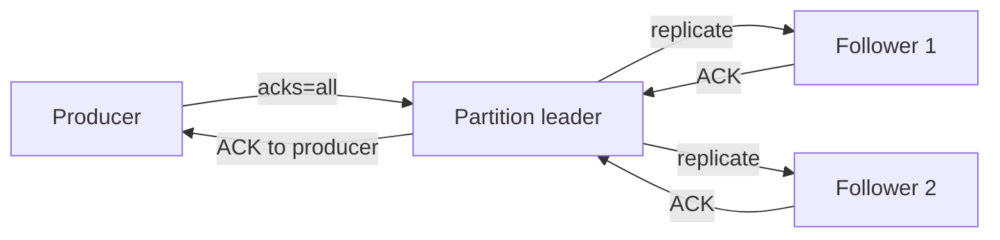
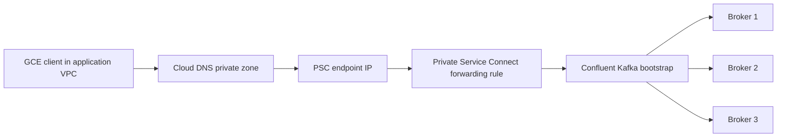
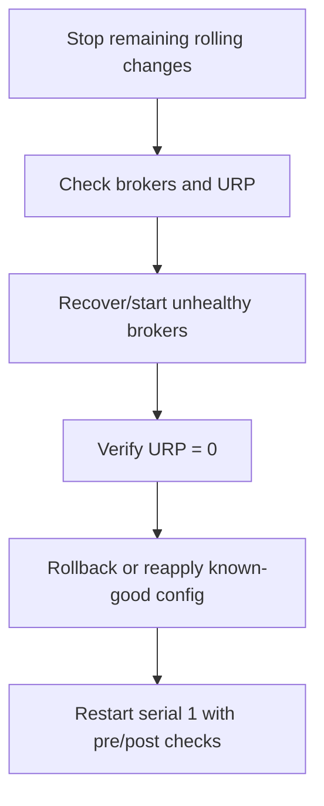

# Kafka Platform Engineer Practical Assessment — Answers

## 1.1 Durability basics



- `acks=all` waits until all in-sync replicas acknowledge the write, not every configured replica. The acknowledgment is sent after the leader and the current ISR followers—including the required minimum—commit the record locally.
- If one broker holding a replica goes offline, the ISR shrinks (for example, to two replicas). A producer using `acks=all` can still succeed if the remaining replicas satisfy `min.insync.replicas=2`.
- If two brokers go offline, a replica factor of 3 leaves only the leader or one follower. With `min.insync.replicas=2`, writes are rejected with `NOT_ENOUGH_REPLICAS`; reads remain available until the cluster cannot serve the remaining replicas safely.
- `min.insync.replicas=2` provides a practical durability/availability tradeoff: one follower can fail while writes still succeed, and a majority-style commit prevents accepting writes with insufficient replicas. Setting it to 3 would eliminate availability during one replica failure.

## 1.2 Confluent Cloud on GCP — Private Service Connect



- Resolution uses the private DNS domain shown in Confluent Networking details, commonly a cluster domain such as `abcdef.us-central1.gcp.confluent.cloud`; with private DNS resolution, GLB endpoints are not used. The private zone must be attached to the GCE application VPC that needs the cluster endpoints.
- A common misconfiguration is omitting an availability zone, attaching the private zone to the wrong VPC, or using public DNS when private DNS was selected. Detect it with `dig +short <bootstrap-endpoint>`, `gcloud dns policies list`, and `gcloud dns managed-zones describe <zone>`; responses should resolve to the VPC's PSC endpoint IPs and all required zonal records must match the forwarding rules.
- Also verify firewall rules permit 443 and 9092, the PSC endpoint IP and forwarding rule exist, and `/etc/resolv.conf` or private DNS policy can resolve the private hostname rather than a public address.

## 1.3 Producer latency triage

Ranked from most to least likely:

1. **Broker request/replica throttling or ISR instability** — Check `RequestHandlerAvgIdlePercent`, `UnderReplicatedPartitions`, producer `request-latency-avg`, and logs for `NotEnoughReplicas` or ISR changes.
2. **Network loss, packet retransmits, or cross-zone latency** — Check producer `network-io-rate`, `request-metrics` in-flight records, broker CPU being flat, and `ping`/packet-loss and retransmission counters on client and broker hosts.
3. **Client-side batching or linger delay** — Check `linger.ms`, `batch-size-avg`, `record-queue-time-avg`, and `request-latency-avg`; throughput that is unchanged may be consistent with larger batches waiting longer.
4. **Broker GC pause or page/cache pressure** — Check broker JVM GC metrics/logs and `GC pause` lines. Run:

```bash
jstat -gcutil -h20 $(pgrep -n -f 'kafka\.Kafka') 1000 20
```

This reports recent heap usage and GC percentage; also inspect `sudo journalctl -u kafka --since "15 minutes ago" | grep -iE 'pause|gc'` or the JVM GC log.

## 1.4 Ansible change gone wrong



- `serial: 3` restarts three brokers simultaneously, potentially losing quorum/ISR capacity on many partitions. A six-broker cluster is especially exposed where replicas for a partition may be concentrated among restarted brokers. It also turns the play from a rolling rollout into a partial multi-broker outage.
- Safety checks should include: broker health/listener readiness; zero under-replicated partitions before and after each restart; and sufficient ISR/broker availability for the restarted broker. A post-restart retry/health wait should also gate the next broker.
- Recovery order:
  1. Stop further rolling changes and prevent the playbook or CI job from continuing.
  2. Check broker processes, listeners, logs, controller status, and ISR/URP health.
  3. Start or recover brokers that are stopped, and resolve storage/network issues before replacing configuration.
  4. Verify affected partitions converge with no under-replicated partitions.
  5. Roll back `server.properties` on a broker, or reapply the known-good value, only after health is restored.
  6. Restart remaining brokers one at a time with pre/post health gates.
  7. Capture the root cause and add `serial: 1`, URP checks, and idempotence validation to the corrected play.

## 1.5 ZooKeeper vs KRaft — short check

ZooKeeper stores and coordinates cluster metadata, broker/controller registration, and elected-controller state in ZooKeeper-based Kafka deployments. KRaft replaces ZooKeeper with Kafka's internal quorum/metadata log and controllers. For a new cluster today, I would select KRaft because it removes the separate ZooKeeper control plane, simplifies operations, and is the modern Kafka architecture. Compatibility with the chosen Kafka/Confluent version and application tooling should still be verified before rollout.
